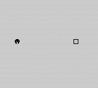

<div align="center">

# Game Boy Forge

Codex skills for designing, building, and testing original Game Boy homebrew.

[](https://github.com/emukid/gameboy-game-development-skills/stargazers)

</div>

## What is this?

Game Boy Forge packages three Codex skills that take a game idea through a concrete design, a compiled ROM, and emulator acceptance tests. Each skill includes instructions and references; the build and verification skills also provide executable helpers, a complete C starter, and a tested sample ROM.

New projects default to DMG-compatible Game Boy and GBDK-2020 C. The references cover Game Boy Color, banking, audio, saves, and existing RGBDS projects; the included executable demonstration covers DMG with a ROM-only cartridge. Game Boy Advance is a separate target.

## Quick Start

Clone the repository and copy the three skill folders into your Codex skills directory:

```sh
git clone https://github.com/emukid/gameboy-game-development-skills.git
cd gameboy-game-development-skills
mkdir -p "${CODEX_HOME:-$HOME/.codex}/skills"
cp -R -i skills/gameboy-design skills/gameboy-build skills/gameboy-verify \
  "${CODEX_HOME:-$HOME/.codex}/skills/"
```

The copy preserves each skill's scripts, references, and assets. If a skill is already installed, review it before accepting any overwrite prompts. Start a new Codex session so the installed skills are discovered, then ask:

```text
Use $gameboy-design, $gameboy-build, and $gameboy-verify to create
a one-screen Game Boy arena game. Deliver the source, compiled ROM,
and a report showing which acceptance tests passed.
```

You can also invoke each skill separately. A design-only request produces a design; a build request should continue through implementation and verification. The starter's collection game is an example to adapt to your requested mechanics.

## The three skills

| Skill | Purpose | Deliverables |
| --- | --- | --- |
| [gameboy-design](skills/gameboy-design/SKILL.md) | Define gameplay, controls, screen layout, assets, and hardware budgets | Game design and deterministic acceptance cases |
| [gameboy-build](skills/gameboy-build/SKILL.md) | Implement GBDK C, convert tile art, scaffold projects, and compile | Source, assets, ROM, map/symbol files, and repeatable build commands |
| [gameboy-verify](skills/gameboy-verify/SKILL.md) | Check ROM headers and exercise gameplay in an emulator | Test results, screenshots, artifact hashes, and stated limitations |

## Try the included game

Open [Three targets](artifacts/three-targets.gb) in a Game Boy emulator. Press **Start**, move with the **D-pad**, and collect three outlined targets. The background inverts on victory; **Start** restarts the game.

<p align="center">
  
</p>

The sample has no text, audio, saves, pause, or lose state. Its complete source and design are in [the starter project](skills/gameboy-build/assets/starter/).

### Build from source

Install Python 3.9+, Make, and a host-matching [GBDK-2020 4.5.0 release](https://github.com/gbdk-2020/gbdk-2020/releases/tag/4.5.0). Extract GBDK and set `GBDK_HOME` to the directory containing `bin/lcc`. From the repository root:

```sh
python3 skills/gameboy-build/scripts/new_project.py /tmp/forge-demo
make -C /tmp/forge-demo GBDK_HOME=/absolute/path/to/gbdk
python3 skills/gameboy-verify/scripts/check_rom.py /tmp/forge-demo/build/game.gb
```

The build produces `game.gb`, `game.map`, and `game.noi` under `/tmp/forge-demo/build/`. Scaffolding refuses an existing destination, so choose a new path when repeating the example.

### Exercise gameplay

Create a virtual environment and install the pinned PyBoy and Pillow dependencies:

```sh
python3 -m venv /tmp/forge-verify
/tmp/forge-verify/bin/python -m pip install -r skills/gameboy-verify/scripts/requirements.txt
/tmp/forge-verify/bin/python skills/gameboy-verify/scripts/test_starter.py \
  /tmp/forge-demo/build/game.gb --symbols /tmp/forge-demo/build/game.noi \
  --screenshot /tmp/forge-play.png
```

This test drives real button input and checks the unchanged starter's title, movement, boundaries, collection, victory, and restart. Choose a new screenshot path on each run; adapt the acceptance cases when you change the game.

On Windows, use the virtual environment's `Scripts/python.exe`, choose native destination paths, and follow the [direct compilation instructions](skills/gameboy-build/references/toolchains.md) if Make is unavailable. The toolchain and Python dependencies are installed separately. No commercial game or proprietary boot ROM is needed.

## Project structure

```text
artifacts/                      # Sample ROM, symbols, screenshot, and test reports
skills/
  gameboy-build/                # Build instructions, scripts, and C starter
  gameboy-design/               # Design instructions and hardware reference
  gameboy-verify/               # ROM checks and emulator tests
tests/                         # Helper regression tests
README.md
VERIFICATION.md                # Recorded validation evidence and limitations
```

## Documentation and verification

| Resource | What it covers |
| --- | --- |
| [Hardware reference](skills/gameboy-design/references/hardware.md) | Display, tiles, sprites, memory, and cartridge budgets |
| [Toolchains](skills/gameboy-build/references/toolchains.md) | GBDK commands and the RGBDS alternative |
| [Implementation guide](skills/gameboy-build/references/implementation.md) | Frame timing, input, collisions, graphics, sound, banking, and saves |
| [Emulator testing](skills/gameboy-verify/references/emulator-testing.md) | Repeatable inputs, observations, and testing limits |
| [Sample design](skills/gameboy-build/assets/starter/GAME_DESIGN.md) | Exact controls, coordinates, state transitions, and acceptance cases |
| [Verification report](VERIFICATION.md) | Tool versions, commands, hashes, results, and untested extension paths |

The recorded demonstration includes identical ROM hashes from two clean builds, 11 passing helper tests, and 25 passing gameplay assertions. CGB, RGBDS, audio, bank switching, battery saves, and physical hardware are documented extension paths and were not validated by this sample.

Run the helper tests from the repository root:

```sh
python3 -m unittest discover -s tests -v
```

## Contributing

Keep changes with the skill they support, preserve its relative references and assets, and run the helper tests. For starter or gameplay-test changes, also compile the ROM and exercise it in the emulator. Include exact commands and observed results when updating verification claims.

<a href="https://github.com/emukid/gameboy-game-development-skills/graphs/contributors">
  
</a>
